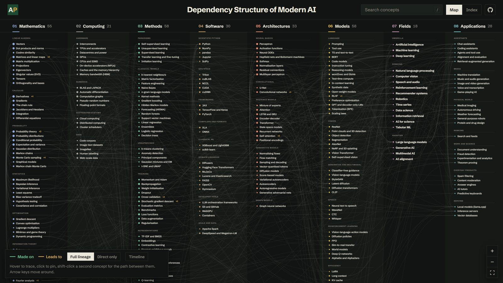
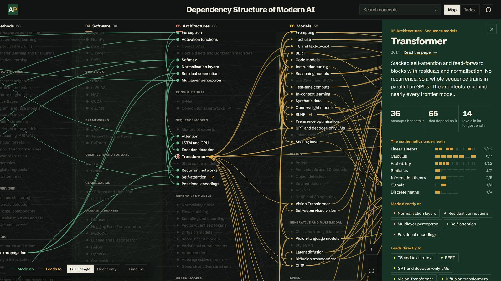

# Dependency Structure of Modern AI

[](https://doi.org/10.5281/zenodo.24157574)

An interactive map of 239 AI concepts and the 630 dependencies between them, in eight layers from mathematics to applications.

**Live:** https://dsmai.aravpanwar.com/






## Using it

- Hover a concept to trace it, click to pin it, and shift-click a second concept to see the path between them.
- Keys: `/` search, arrow keys walk the map, `+` and `-` zoom, `0` fits the whole map, `Esc` clears.
- Links: `#transformer` opens a concept, `#matmul..chat` opens a path.
- `?theme=light` switches to the light theme, and `?embed` gives a stripped-down version for embedding in a page.

## Run locally

No build step. Serve the folder with any static server:

```sh
python -m http.server 8000
```

## Data

Concepts and dependencies are in `assets/js/data.js`. After editing, validate with:

```sh
node scripts/check.js
```

## Licence

- Code: [MIT](LICENSE).
- Data in `assets/js/data.js`: [CC BY 4.0](https://creativecommons.org/licenses/by/4.0/). Credit Arav Panwar and link to https://dsmai.aravpanwar.com/.
- Font in `assets/fonts`: Schibsted Grotesk, [SIL Open Font License 1.1](assets/fonts/OFL.txt).

## Citation

See [CITATION.cff](CITATION.cff).
