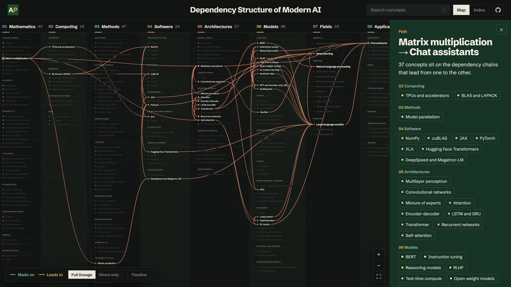
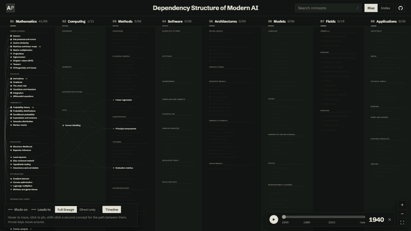

# Dependency Structure of Modern AI

[](https://doi.org/10.5281/zenodo.24157574)

A learning reference for modern AI. Pick any concept, from linear algebra to chat assistants, and see what it is built on and the order to learn those things in. 301 concepts and 827 dependencies, in eight layers from mathematics to applications.

**Live:** https://dsmai.aravpanwar.com/






## Using it

- Study list: open a concept and choose "Study list" to get everything under it in the order to learn it, with checkboxes saved in your browser and a copy-as-checklist button.
- Hover a concept to trace it, click to pin it, and shift-click a second concept to see the path between them.
- Keys: `/` search, arrow keys walk the map, `+` and `-` zoom, `0` fits the whole map, `Esc` clears.
- Nesting: finer concepts (Bayes' theorem inside probability theory, grouped-query attention inside self-attention) are folded under their parent. Click the `+2` next to a parent to open it; search and links open it for you.
- Links: `#transformer` opens a concept, `#matmul..chat` opens a path, `#study:transformer` opens a study list.
- `?theme=light` switches to the light theme, and `?embed` gives a stripped-down version for embedding in a page.

## Run locally

No build step. Serve the folder with any static server:

```sh
python -m http.server 8000
```

## Data

Concepts and dependencies are in `assets/js/data.js`. After editing, validate with:

```sh
node scripts/check.js
```

## Licence

- Code: [MIT](LICENSE).
- Data in `assets/js/data.js`: [CC BY 4.0](https://creativecommons.org/licenses/by/4.0/). Credit Arav Panwar and link to https://dsmai.aravpanwar.com/.
- Font in `assets/fonts`: Schibsted Grotesk, [SIL Open Font License 1.1](assets/fonts/OFL.txt).

## Citation

See [CITATION.cff](CITATION.cff).
