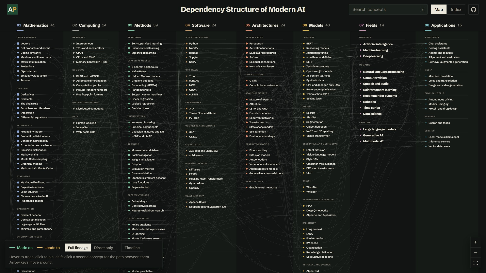
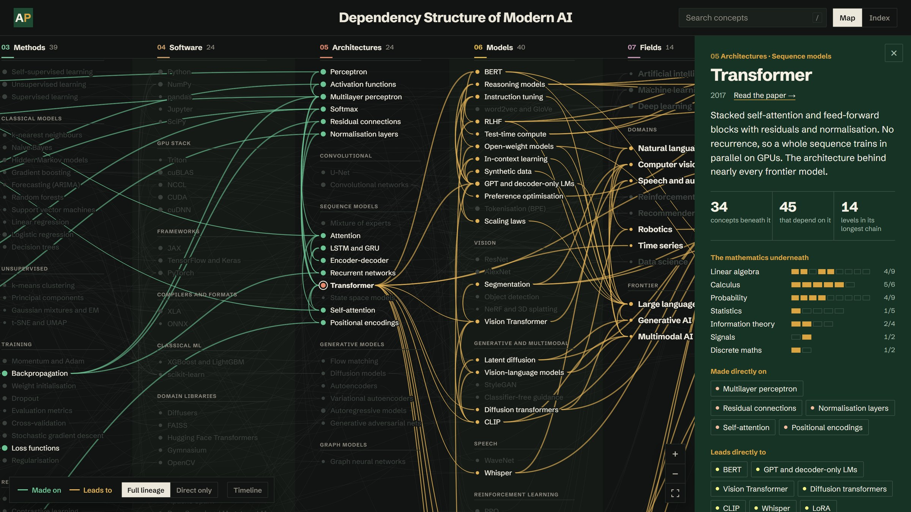
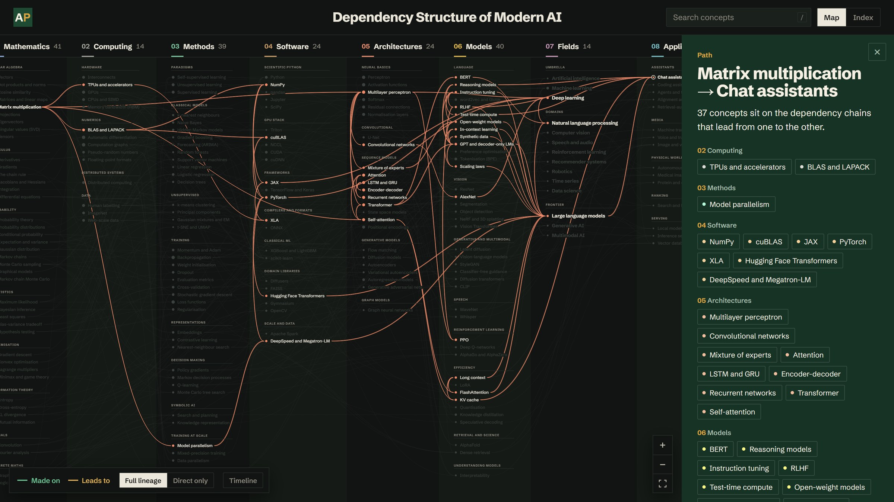
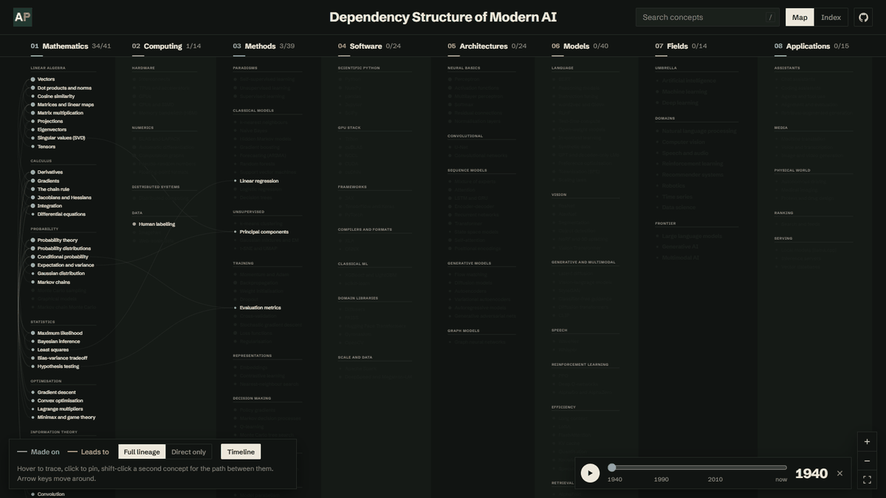

# Dependency Structure of Modern AI

[](https://doi.org/10.5281/zenodo.24157574)

An interactive map of 211 AI concepts and the 522 dependencies between them, in eight layers from mathematics to applications.

**Live:** https://dsmai.aravpanwar.com/









## Run locally

No build step. Serve the folder with any static server:

```sh
python -m http.server 8000
```

## Data

Concepts and dependencies are in `assets/js/data.js`. After editing, validate with:

```sh
node scripts/check.js
```

## Licence

Code: [MIT](LICENSE). Data in `assets/js/data.js`: [CC BY 4.0](https://creativecommons.org/licenses/by/4.0/).

## Citation

See [CITATION.cff](CITATION.cff).
